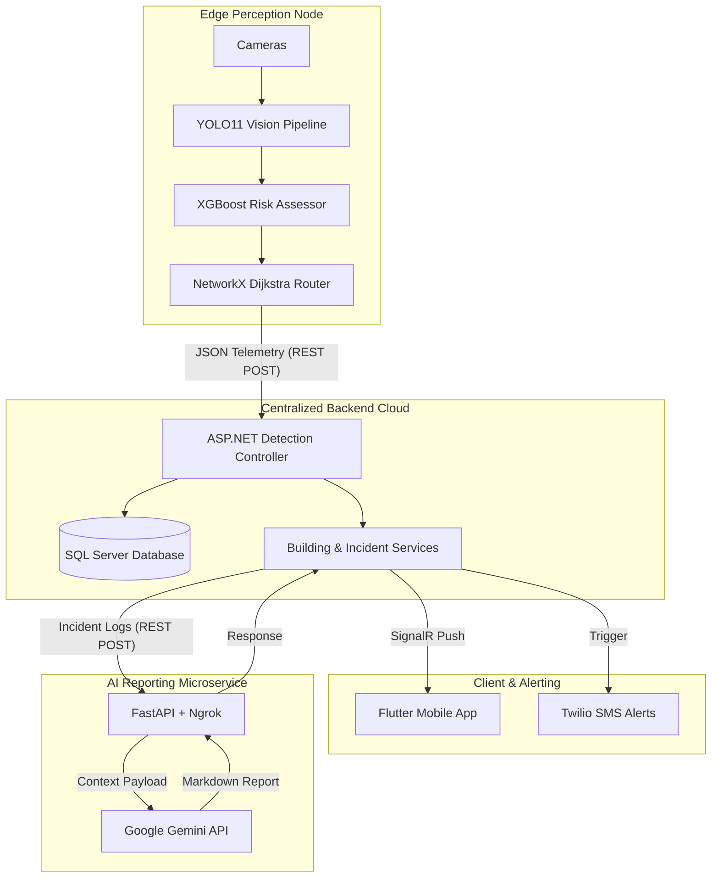

<div align="center">

# 🚨 ESCAPIA - AI Emergency Evacuation🚨
**Real-Time AI Emergency Evacuation & Dynamic Routing System**

[](https://www.python.org/)
[](https://fastapi.tiangolo.com/)
[](https://ultralytics.com/)
[](https://xgboost.readthedocs.io/)
[](https://dotnet.microsoft.com/)
[]()
[](https://ai.google.dev/)
[](https://ngrok.com/)

*ESCAPIA-AI is an intelligent, edge-computed perception and evacuation ecosystem. It dynamically routes crowds away from life-threatening hazards (fire/smoke) in real-time, utilizing advanced computer vision, machine learning risk assessment, robust backend state management, and Generative AI for automated post-incident reporting.*

**[🎥 Watch the Live Demo Video Here](#)** | **[📄 View the Presentation Slides Here](#)**

</div>

---

## 📖 Table of Contents

1. [System Architecture](#1-system-architecture)
2. [Core AI & Machine Learning Engine](#2-core-ai--machine-learning-engine)
3. [Backend State Management & Integration](#3-backend-state-management--integration)
4. [Generative AI Incident Reporting](#4-generative-ai-incident-reporting)
5. [Repository Structure](#5-repository-structure)
6. [API Specifications](#6-api-specifications)
7. [Judging & Live Deployment Guide](#7-judging--live-deployment-guide)

---

## 1. 🏗️ System Architecture

ESCAPIA operates on a highly resilient, distributed, service-oriented architecture designed to bridge Edge AI, Cloud Backend, and Mobile interfaces seamlessly.



---

## 2. 🧠 Core AI & Machine Learning Engine

### 2.1 Dual-Model Edge Perception (Computer Vision)

- **Architecture:** A dual-instance YOLO inference pipeline running two separate `YOLO11n` instances (one per camera feed) alongside a dedicated fine-tuned hazard-detection model, allowing independent tracker states per physical zone.
- **Crowd Tracking:** Integrated YOLO11n with the **ByteTrack** algorithm (`tracker="bytetrack.yaml", persist=True`) to assign persistent track IDs. *(Note: Current per-frame count captures instantaneous capacity).*
- **Hazard Detection:** Utilizes a custom fine-tuned YOLO model (`best.pt`) explicitly for real-time fire (`conf ≥ 0.45`) and smoke (`conf ≥ 0.60`) detection.
- **Temporal Filtering (Anti-Flicker):** Implemented a leaky-bucket sticky-memory counter per zone (+3 on detection, -2 decay, capped at 60). Fire/smoke states are only confirmed after sustained detection, drastically mitigating false positives from transient camera artifacts.

### 2.2 XGBoost Risk Assessment & Dynamic Routing

- **Risk Modeling:** Employs an `XGBRegressor` (`xgb_risk_model.json`) trained on synthetic environmental datasets (fire status, density, zone capacity) to output real-time risk scores.
- **Graph-Based Pathfinding:** The facility is modeled as a weighted graph using `NetworkX`.
- **Dynamic Dijkstra Routing:** Modified Dijkstra's algorithm applies XGBoost risk scores as dynamic edge-weight penalties. Edges connecting to a zone/exit at or above the critical threshold (85%) receive an infinite penalty (`999,999`), effectively blocking the route.
- **Shelter-In-Place Protocol:** If no viable path exists below the critical threshold, the system intelligently defaults to a `STAY_AND_WAIT` command instead of routing crowds through danger.

### 2.3 Multithreaded I/O & Telemetry

- **Reduced-Latency Streaming:** A custom threaded `CameraStream` class decouples frame capture from model inference, bypassing OpenCV's internal buffer backlog to maintain high FPS across both Local Webcam (Zone 1) and IP Camera (Zone 2) feeds.
- **Resilient Transmission:** Pushes JSON telemetry to the backend every 30 frames. Wrapped in `try/except` with a strict `timeout=0.5s`, ensuring a slow or unreachable backend never blocks the critical real-time camera loop.
- **Data Auditing:** Persists frame-by-frame telemetry locally to a `.jsonl` file for offline analysis.

---

## 3. ☁️ Backend State Management & Integration

The **ASP.NET Core 8** backend acts as the central nervous system, bridging AI insights with human action. It receives AI risk assessments and evacuation decisions, storing and forwarding them without translation delays.

- **Real-Time Communication:** Utilizes **SignalR** to push instantaneous warnings and dynamic route updates (in both Arabic and English) to the Flutter mobile application.
- **Emergency Dispatch:** Integrates with the **Twilio Service** for external SMS alerting.
- **Data Persistence:** Built on Entity Framework (EF Core) and SQL Server to reliably log incident tracking and building states.

---

## 4. 🤖 Generative AI Incident Reporting

- **Microservice Architecture:** An independent **FastAPI** service (`report_generator.py`) handles the heavy lifting of post-incident analysis.
- **Log Compression Algorithm:** Detects state changes (route alterations, risk spikes) to collapse redundant frames into a highly condensed event timeline.
- **Hard-Cap Token Management:** Employs head/tail sampling to strictly cap the timeline at `MAX_SAFE_EVENTS`, optimizing payload size for the LLM context window.
- **Gemini Integration:** Invokes the **Google Gemini API** (`gemini-3.6-flash`) to analyze the compressed timeline, automatically generating a structured, highly readable Markdown Post-Incident Report (featuring an Executive Summary, Critical Timeline, Routing logic, and Recommendations).

---

## 5. 📂 Repository Structure

```text
ESCAPIA_WORKSPACE/
│
├── ESCAPIA-AI/                              # Python Vision & ML Engine
│   ├── main.py                              # Core perception and routing loop
│   ├── decision_engine.py                   # XGBoost & NetworkX routing logic
│   ├── report_generator.py                  # FastAPI Generative AI microservice
│   ├── train_risk_model.py                  # XGBoost training script
│   ├── requirements.txt                     # Python dependencies
│   ├── best.pt                              # Fine-tuned Fire/Smoke model
│   ├── yolo11n.pt                           # YOLO11 Nano model
│   ├── xgb_risk_model.json                  # Compiled risk weights
│   └── .env                                 # Local API keys and URLs
│
├── ESCAPIA-AI-BACKEND/                            # ASP.NET Core 8 API
│   ├── Controllers/
│   │   ├── AuthController.cs
│   │   ├── DetectionController.cs
│   │   ├── BuildingController.cs
│   │   └── IncidentController.cs
│   ├── Services/
│   │   ├── AuthService.cs
│   │   ├── DetectionService.cs
│   │   ├── BuildingStateService.cs
│   │   ├── IncidentReportService.cs
│   │   └── TwilioService.cs
│   ├── DTOs/
│   ├── Models/
│   ├── Data/
│   │   └── ApplicationDb.cs
│   ├── Hubs/
│   │   └── BuildingHub.cs                   # SignalR Real-Time Hub
│   └── Extensions/
│       └── AuthenticationExtensions.cs
│
└── EscaplA-flutter/                         # Cross-Platform Flutter Client App
    ├── android/                             # Android native configuration & build files
    │   ├── app/
    │   │   └── src/
    │   │       ├── debug/AndroidManifest.xml
    │   │       ├── main/ (kotlin, res, AndroidManifest.xml)
    │   │       └── profile/build.gradle.kts
    │   └── gradle/wrapper/
    ├── assets/images/                       # UI Image Assets & Logos
    │   ├── circles.png
    │   ├── escapia_app_logo.png
    │   ├── escapia_logo_transparent.png
    │   └── quarter_circles.png
    ├── ios/                                 # iOS native setup & Xcode project files
    │   ├── Flutter/ (Configs & .plist)
    │   ├── Runner.xcodeproj/
    │   ├── Runner.xcworkspace/
    │   ├── Runner/
    │   └── RunnerTests/
    ├── lib/                                 # Main Flutter source directory
    │   ├── core/                            # Core themes, configurations & utilities
    │   ├── features/                        # Modular feature implementations
    │   └── main.dart                        # Application entry point
    ├── test/                                # Testing suite
    │   └── widget_test.dart
    ├── web/                                 # Web hosting support & favicons
    │   ├── icons/
    │   ├── splash/img/
    │   ├── favicon.png
    │   ├── index.html
    │   └── manifest.json
    ├── .metadata                            # Flutter metadata configuration
    ├── analysis_options.yaml                # Static analysis linter rules
    ├── pubspec.yaml                         # Flutter package dependencies & assets binding
    └── pubspec.lock                         # Locked dependency versions
```

---

## 6. 📡 API Specifications

### Backend REST Endpoints

| Method | Endpoint | Purpose |
|--------|----------|---------|
| `POST` | `/api/Detection` | Ingests AI Telemetry & Risk States |
| `GET` | `/api/Build` | Retrieves current Building State |
| `GET` | `/api/Incidents/{id}/report` | Fetches AI-Generated Incident Report |
| `GET` | `/api/Incidents/incidents` | Lists Historical Incidents |
| `POST` | `/api/Auth` | User/Admin Authentication (JWT) |
| `POST` | `/api/Auth` | Login |
| `POST` | `/api/Incidents/incidents` | Incidents |

### AI Outbound Payload (Sent to `/api/Detection`)

```json
{
  "zoneId": "Zone_1",
  "fireDetected": true,
  "smokeDetected": false,
  "peopleCount": 12,
  "crowdDensity": "High",
  "riskLevel": "High",
  "evacuationRequired": true,
  "instruction": "Evacuate immediately via Exit_A.",
  "fullRoute": ["Zone_1", "Zone_3", "Exit_A"],
  "isRerouted": true,
  "safeExitsCount": 1,
  "totalExits": 2
}
```

---

## 7. ⚖️ Judging & Live Deployment Guide

For evaluators and judges reviewing the live system, follow these steps to execute the full Edge-to-Cloud-to-Mobile pipeline:

### Step 1: Environment Setup

1. Clone the repository and navigate to the AI directory.
2. Create a `.env` file containing the following:

```env
GEMINI_API_KEY="your_google_gemini_key"
BACKEND_API_URL="http://[your_backend_domain]/api/Detection/"
IP_CAMERA_URL="http://[mobile_ip_webcam]:4747/video"
```

### Step 2: Launch the AI Reporting Microservice

Run the FastAPI service locally on port 8000:

```bash
uvicorn report_generator:app --port 8000
```

**Public Routing:** To ensure the external ASP.NET backend can reach this local service to generate reports, expose it using Ngrok in a separate terminal:

```bash
ngrok http 8000
```

*(Provide the generated `https://*.ngrok-free.app` URL to the backend configuration).*

### Step 3: Initialize the Edge Perception Engine

Launch the main multithreaded AI vision system:

```bash
python main.py
```

### Step 4: Live Simulation Controls

While `main.py` is rendering the live camera feeds, you can interactively simulate emergency blocked routes to test the dynamic pathfinding:

- Press `a` : Force **Exit_A** Risk to 90% (Simulates Blocked Path)
- Press `s` : Reset **Exit_A** Risk to 0%
- Press `d` : Force **Exit_B** Risk to 90% (Simulates Blocked Path)
- Press `f` : Reset **Exit_B** Risk to 0%
- Press `q` : Graceful System Shutdown
